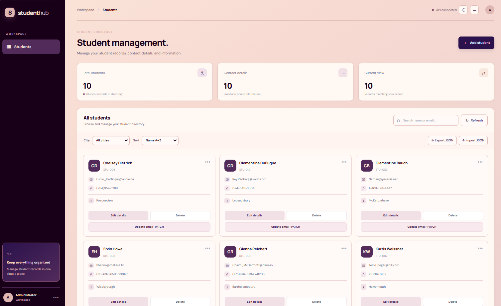
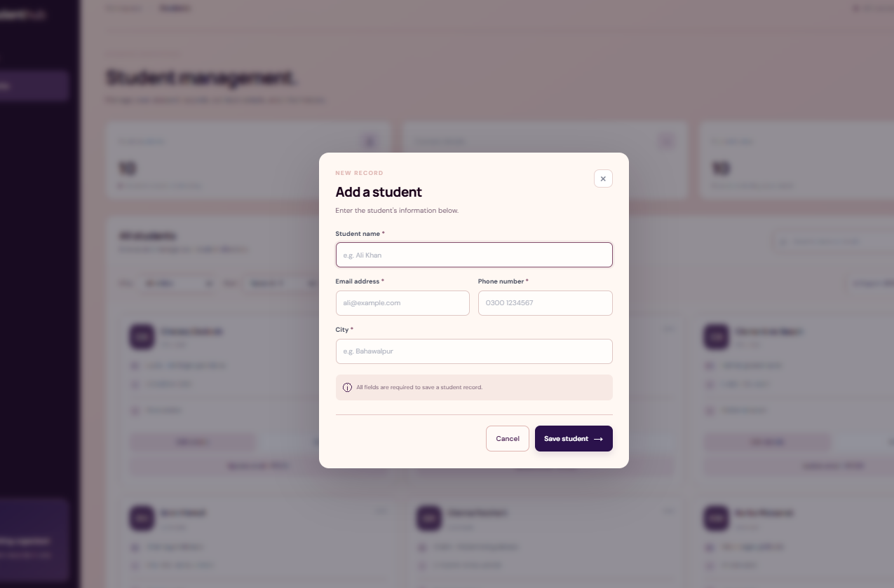

# StudentHub — Student Management System

<div align="center">

### A smarter way to manage student records.

A web-based student management application designed to organize, manage, search, and maintain student information through a clean and intuitive dashboard.

**[Live Demo](https://aysprog.github.io/student_management_system/)**

</div>

---

## About the Project

**StudentHub** is a frontend web application developed to simplify student record management through a centralized dashboard.

The application provides an organized interface for managing student information, including personal details and contact records. It combines CRUD operations, API integration, data filtering, and record management utilities in one workspace.

The interface features a modern visual design with a deep plum sidebar, soft blush background, and warm neutral surfaces to create a clean and comfortable user experience.

## Features

### Student Management
- Add new student records.
- View student information in an organized directory.
- Edit existing student details.
- Delete student records.
- Update student email information using PATCH requests.

### Search & Organization
- Search students by name or email.
- Filter student records by city.
- Sort records alphabetically by name.
- Navigate through records using pagination.

### Dashboard & Data Management
- Dashboard statistics for total students and contact details.
- Current search result count.
- JSON data export.
- JSON data import.
- Refresh student records.
- API connection status indicator.

### User Interface
- Clean dashboard layout.
- Organized student record cards.
- Dedicated add-student form.
- Light and dark appearance controls.
- Consistent styling and visual hierarchy.

## Technologies Used

| Technology | Purpose |
|---|---|
| HTML5 | Application structure |
| CSS3 | Styling and layout |
| JavaScript (ES6+) | Application logic and interactivity |
| REST API | Student data operations |
| JSON | Data import and export |
| Git & GitHub | Version control and hosting |
| GitHub Pages | Application deployment |

## Website Preview

### Student Dashboard



### Add Student Form



## Project Structure

```text
student_management_system/
│
├── index.html
├── style.css
├── script.js
├── README.md
│
└── screenshots/
    ├── studenthub-dashboard.png
    ├── studenthub-records.png
    └── studenthub-add-student.png
```

## Getting Started

Follow these steps to run the project locally.

**1. Clone the repository**

```bash
git clone https://github.com/aysprog/student_management_system.git
```

**2. Navigate to the project directory**

```bash
cd student_management_system
```

**3. Open the project**

Open `index.html` in your browser or use the Live Server extension in Visual Studio Code.

**Note:** API-dependent features require an internet connection and an accessible API service.

## Live Application

Explore the deployed application:

**[Open StudentHub — Live Demo](https://aysprog.github.io/student_management_system/)**

## Project Purpose

This project is part of my frontend development journey, focused on applying JavaScript concepts to a practical student record management application.

It provides hands-on experience with CRUD operations, API communication, data handling, and building structured user interfaces.

---

<div align="center">

**StudentHub**

*Designed and developed by Ayesha Athar.*

[GitHub](https://github.com/aysprog) · [LinkedIn](https://www.linkedin.com/in/ayesha-athar-b2617b445)

</div>
